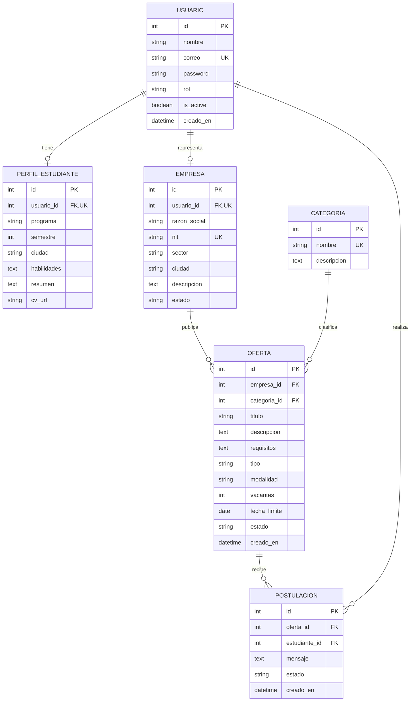

# Diseño del modelo de datos

## Decisiones de diseño

- Se mantienen las seis entidades principales solicitadas en el plan.
- `Usuario` usa el mecanismo de autenticación de Django con correo como identificador (`USERNAME_FIELD`). La contraseña se almacena con el hash gestionado por Django, nunca en texto plano.
- `PerfilEstudiante` y `Empresa` son extensiones uno a uno de `Usuario`. La cuenta de empresa tiene un perfil con estado de aprobación.
- `Postulacion` referencia a `Usuario` y su formulario/view restringe la postulación al rol estudiante. La restricción única en base de datos impide duplicados incluso ante solicitudes simultáneas.
- Los nombres de tablas y campos siguen convenciones legibles; los nombres técnicos concretos podrán ajustarse al implementar los modelos.

## Entidades y campos

| Entidad | Campos principales | Reglas e integridad |
|---|---|---|
| `Usuario` | `id` (PK), `nombre`, `correo`, `password`, `rol`, `is_active`, `is_staff`, `creado_en` | `correo` único; `rol`: estudiante, empresa o administrador. `password` gestionado por Django. `is_staff` habilita el admin de Django, no sustituye las comprobaciones de rol. |
| `PerfilEstudiante` | `id` (PK), `usuario_id` (FK 1:1), `programa`, `semestre` (opcional), `ciudad`, `habilidades`, `resumen`, `cv_url` (opcional) | Un perfil por usuario estudiante. Borrado en cascada al eliminar la cuenta. |
| `Empresa` | `id` (PK), `usuario_id` (FK 1:1), `razon_social`, `nit`, `sector`, `ciudad`, `descripcion`, `estado`, `creado_en` | `nit` único; `estado`: pendiente, aprobada o rechazada. Una sola empresa por cuenta con rol empresa. |
| `Categoria` | `id` (PK), `nombre`, `descripcion` | `nombre` único. Las categorías referenciadas por ofertas no se eliminan en cascada. |
| `Oferta` | `id` (PK), `empresa_id` (FK), `categoria_id` (FK), `titulo`, `descripcion`, `requisitos`, `tipo`, `modalidad`, `vacantes`, `fecha_limite`, `estado`, `creado_en` | `tipo`: práctica o empleo. `modalidad`: presencial, remota o híbrida. `vacantes > 0`. `estado`: pendiente, publicada o cerrada. La fecha límite no puede ser pasada al crear. |
| `Postulacion` | `id` (PK), `oferta_id` (FK), `estudiante_id` (FK a Usuario), `mensaje` (opcional), `estado`, `creado_en` | Única por pareja `(oferta_id, estudiante_id)`. `estado`: enviada, en revisión, preseleccionado, rechazado, contratado o retirada. |

## Relaciones

- `Usuario` 1 — 0..1 `PerfilEstudiante`.
- `Usuario` 1 — 0..1 `Empresa`.
- `Empresa` 1 — N `Oferta`.
- `Categoria` 1 — N `Oferta`.
- `Oferta` 1 — N `Postulacion`.
- `Usuario` estudiante 1 — N `Postulacion`.

## Política de borrado y validaciones

- Perfiles y empresa: `CASCADE` desde su usuario.
- Ofertas: `PROTECT` o `RESTRICT` desde empresa y categoría, para evitar perder historial o dejar ofertas sin clasificar. La empresa puede cerrar una oferta en vez de borrarla.
- Postulaciones: `CASCADE` desde oferta y usuario estudiante. En la interfaz se prioriza retirar o cerrar; el borrado físico queda para gestión autorizada.
- Los `choices`, la validación de formularios y las restricciones de base de datos se complementan. Las reglas de autorización y fechas también se verifican en servidor.
- Los estados de postulación requieren transiciones explícitas; el estudiante solo puede retirar su propia postulación y la empresa solo puede cambiar las de sus ofertas.

## Índices sugeridos

Además de unicidad, indexar `Oferta(estado, fecha_limite)`, `Oferta(tipo, modalidad)`, `Oferta(categoria, ciudad de empresa)` y `Postulacion(oferta, estado)` si los filtros y reportes muestran necesidad. La optimización final se confirma con consultas reales.
