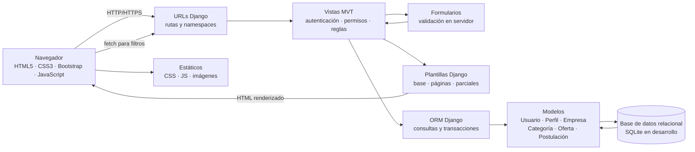

# Arquitectura de la aplicación

## Diagrama Full Stack

## Flujo de una petición

1. El navegador solicita una URL o envía un formulario con CSRF.
2. El enrutador de Django resuelve la ruta y llama a la vista correspondiente.
3. La vista comprueba sesión, rol, propiedad del recurso y reglas de negocio.
4. Los formularios validan entradas en servidor; el JavaScript ofrece validación inmediata complementaria.
5. La vista consulta o modifica los modelos usando el ORM y la base relacional.
6. Django renderiza una plantilla completa o un parcial para la búsqueda dinámica. Los mensajes de éxito o error se presentan en la zona global de avisos.

## Organización por aplicaciones

| Aplicación | Responsabilidad |
|---|---|
| `cuentas` | Usuario personalizado, registro, autenticación, perfiles, permisos y gestión de cuentas. |
| `ofertas` | Categorías, ofertas, búsqueda, filtros y flujo de aprobación. |
| `postulaciones` | Crear y retirar candidaturas, listados y cambios de estado. |
| `panel` | Dashboard, reportes y exportación CSV. |
| `config` | Configuración del proyecto, URL raíz, configuración regional y ajustes de despliegue. |

Las páginas comparten `base.html`, componentes de formulario, mensajes, etiquetas de estado, tarjetas y paginación. Los datos visibles se suministran por las vistas desde la base de datos.

## Entornos y errores

- Desarrollo: SQLite, `DEBUG=True` únicamente en entorno local y secretos en variables de entorno.
- Sustentación/despliegue: `DEBUG=False`, `ALLOWED_HOSTS` configurado y páginas propias para 403, 404 y 500.
- Autorización: autenticación más decoradores o mixins por rol; cada consulta de recursos empresariales se limita a la empresa propietaria.
- Persistencia: migraciones versionadas; el seed de demostración se define en la fase de modelos.
