# Manual de usuario

## Introducción

La Plataforma de Prácticas y Oportunidades Laborales reúne ofertas, perfiles y postulaciones. Los permisos cambian según el tipo de cuenta. Los campos marcados con * son obligatorios; los mensajes de estado aparecen en la parte superior de la página.

## Acceso y creación de cuenta

1. Abre la página inicial y selecciona **Crear cuenta**.
2. Elige **Estudiante o egresado** o **Empresa**.
3. Completa el formulario y envíalo. La contraseña debe cumplir los requisitos que muestra el formulario.
4. Entra con el correo y la contraseña registrados.

El registro de empresa queda pendiente. El administrador debe aprobarlo antes de que pueda crear ofertas.

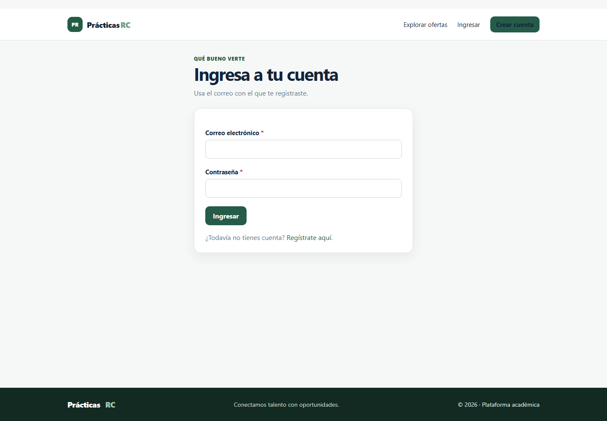

## Estudiante o egresado

### Perfil

En **Mi perfil**, consulta el programa académico, ciudad y demás datos. Usa **Editar perfil** para actualizar el nombre, programa, semestre, ciudad, habilidades, resumen profesional y, opcionalmente, un enlace a la hoja de vida.

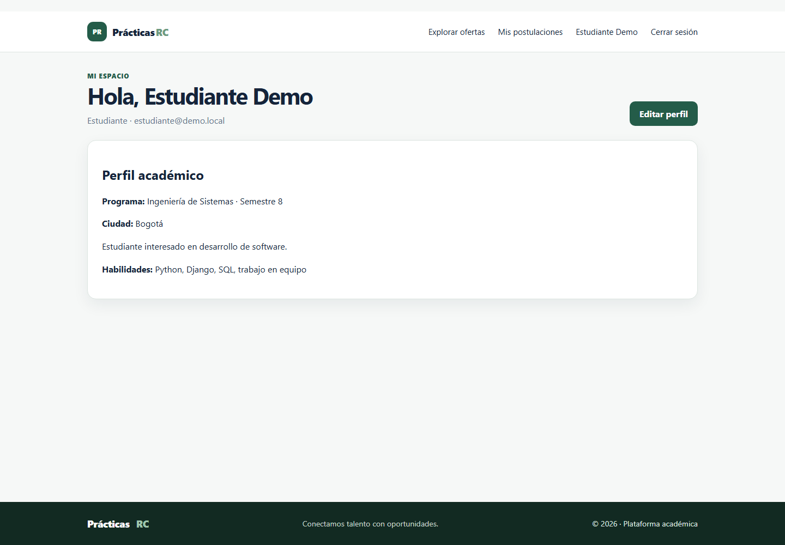

### Buscar ofertas

1. Entra en **Explorar ofertas**.
2. Escribe un cargo, empresa o habilidad. También puedes filtrar por tipo, categoría, modalidad y ciudad.
3. Cambia los filtros para actualizar los resultados; la lista y la paginación se refrescan sin recargar la página.
4. Abre una tarjeta para leer descripción, requisitos, vacantes y fecha límite.

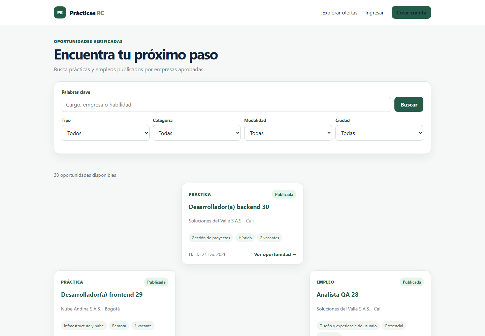

### Postularse y hacer seguimiento

En el detalle de una oferta vigente, escribe un mensaje opcional y pulsa **Postularme**. Una segunda postulación a la misma oferta se bloquea. En **Mis postulaciones**, consulta el estado o retira una candidatura que siga activa.

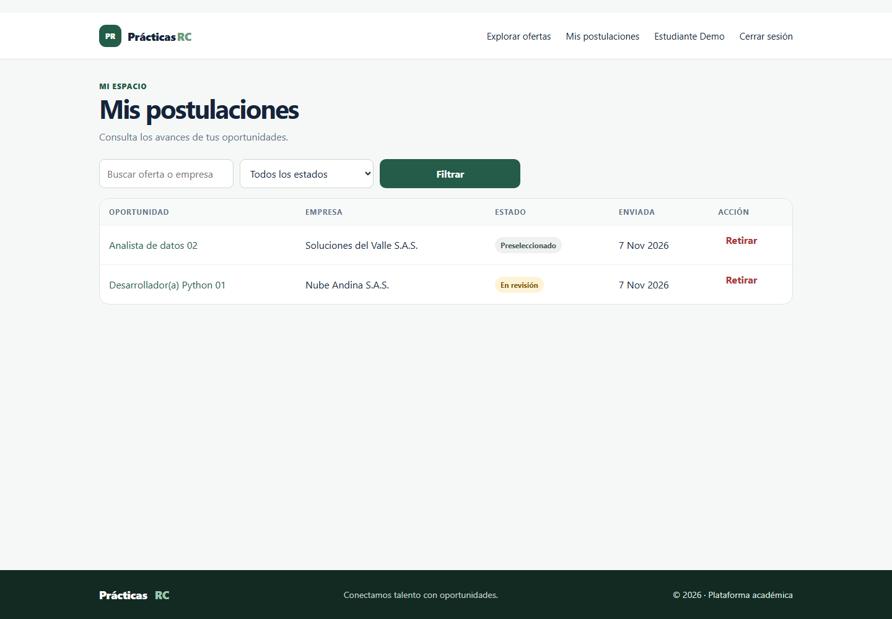

## Empresa

### Esperar aprobación

Después de registrarse, la empresa aparece como pendiente. Puede revisar y actualizar sus datos, pero no crear ofertas hasta que el administrador apruebe el registro.

### Crear y administrar ofertas

1. Desde **Mis ofertas**, pulsa **Crear oferta**. Esta opción se habilita después de la aprobación de la empresa.
2. Completa categoría, título, descripción, requisitos, tipo, modalidad, vacantes y fecha límite futura.
3. Guarda. La nueva oferta queda pendiente de revisión administrativa.
4. Editar una oferta la devuelve a pendiente para que vuelva a revisarse. Usa **Cerrar** para dejar de recibir postulaciones.

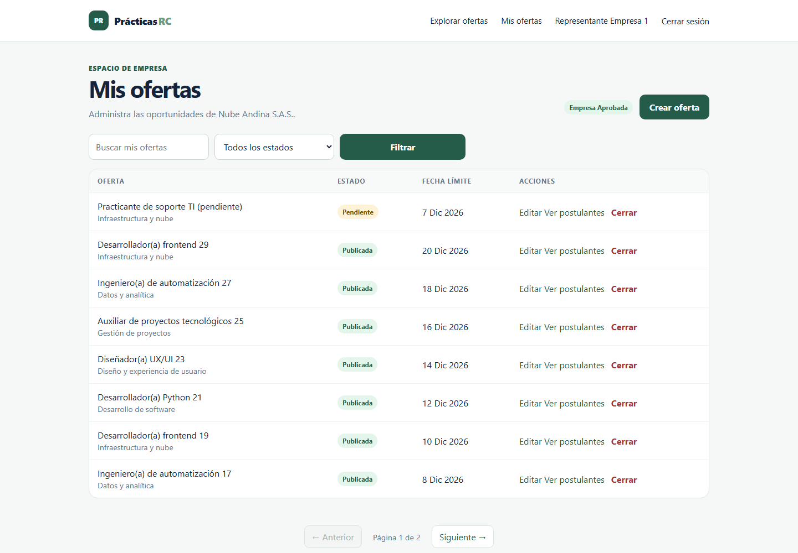

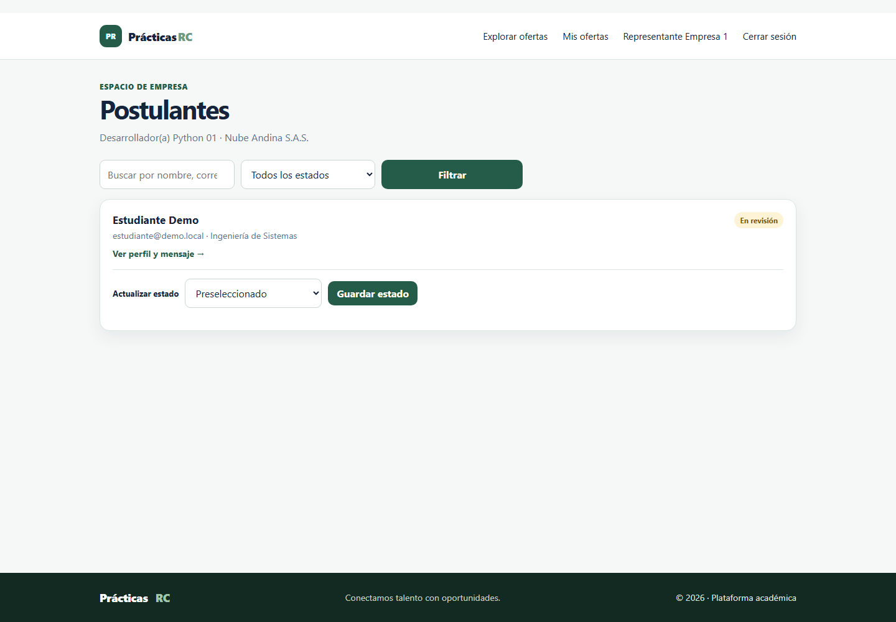

### Revisar postulantes

Abre los postulantes de una oferta propia, filtra por estado o busca por estudiante. Desde el perfil del candidato consulta formación, ciudad, habilidades y mensaje. Cambia el estado usando únicamente las transiciones que ofrece el sistema.

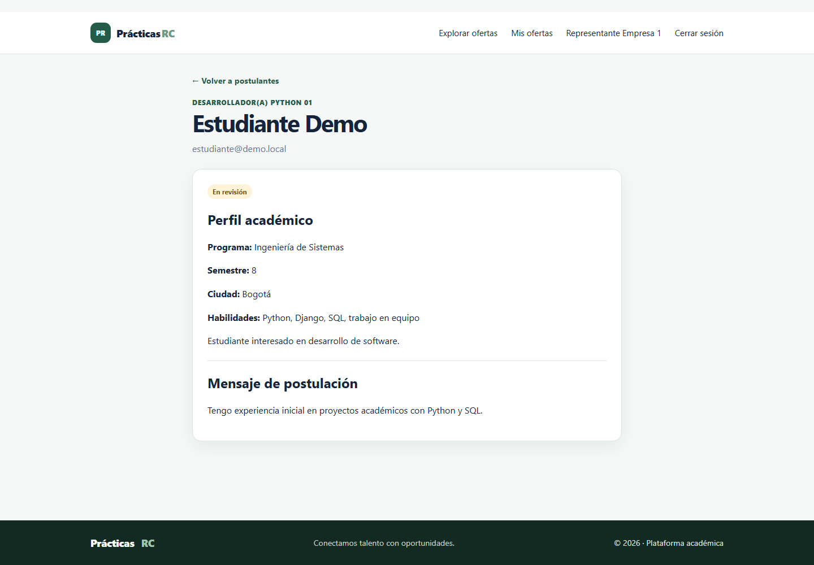

## Administrador

### Panel e indicadores

El panel muestra empresas aprobadas, ofertas publicadas, postulaciones y vinculaciones. Los gráficos se calculan desde la base de datos; si el CDN de gráficos no está disponible, queda el resumen en texto.

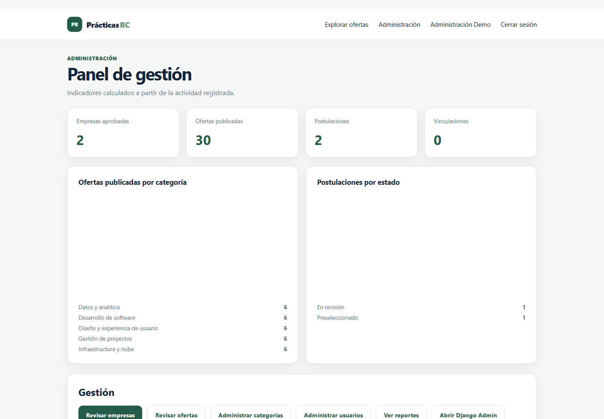

### Aprobaciones y gestión

- En **Revisar empresas**, aprueba o rechaza solicitudes pendientes.
- En **Revisar ofertas**, publica o rechaza propuestas. Una oferta no se puede publicar si su empresa no está aprobada.
- En **Administrar categorías**, crea, busca, edita o elimina categorías. El sistema impide borrar una categoría utilizada por ofertas.
- En **Administrar usuarios**, busca cuentas, actualiza roles y activa o desactiva usuarios. No se permite desactivar la última cuenta administradora activa ni modificar desde allí la cuenta del administrador conectado.

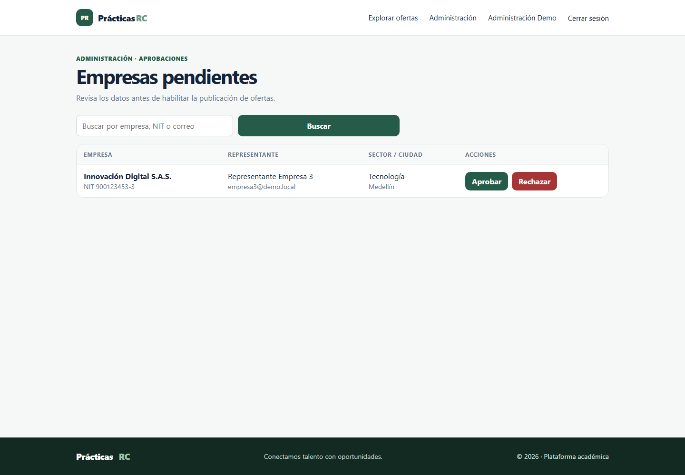

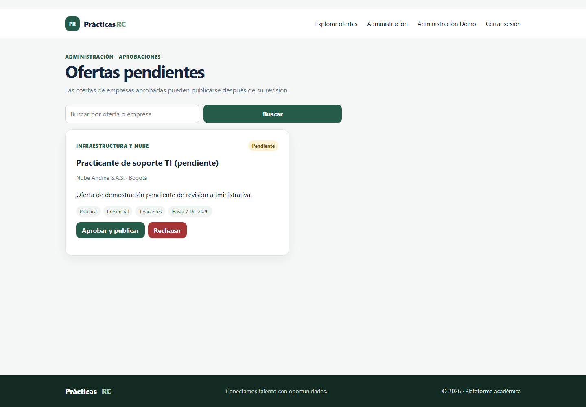

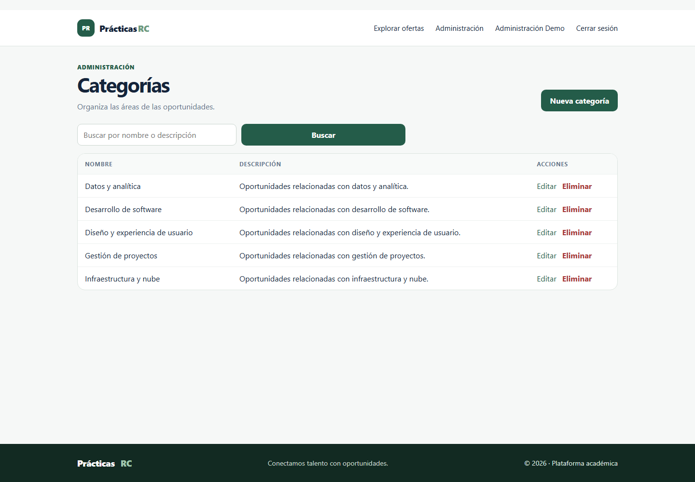

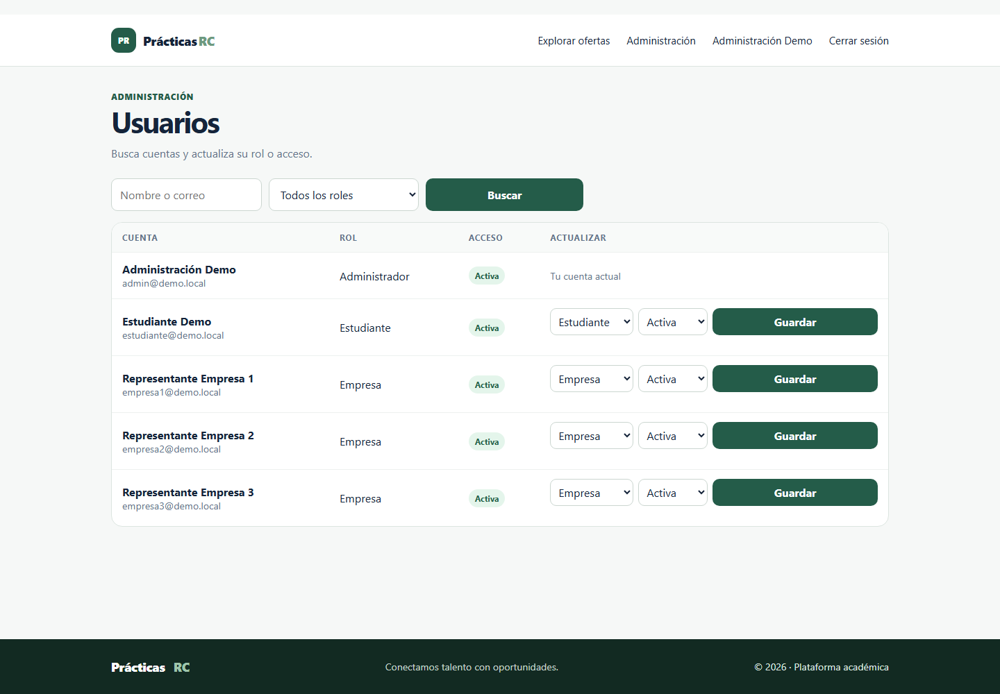

### Reportes

Abre **Ver reportes**, elige periodo y categoría y, si lo necesitas, busca por estudiante, empresa u oferta. La tabla se pagina. Pulsa **Descargar CSV** para exportar todos los registros que coincidan con los filtros.

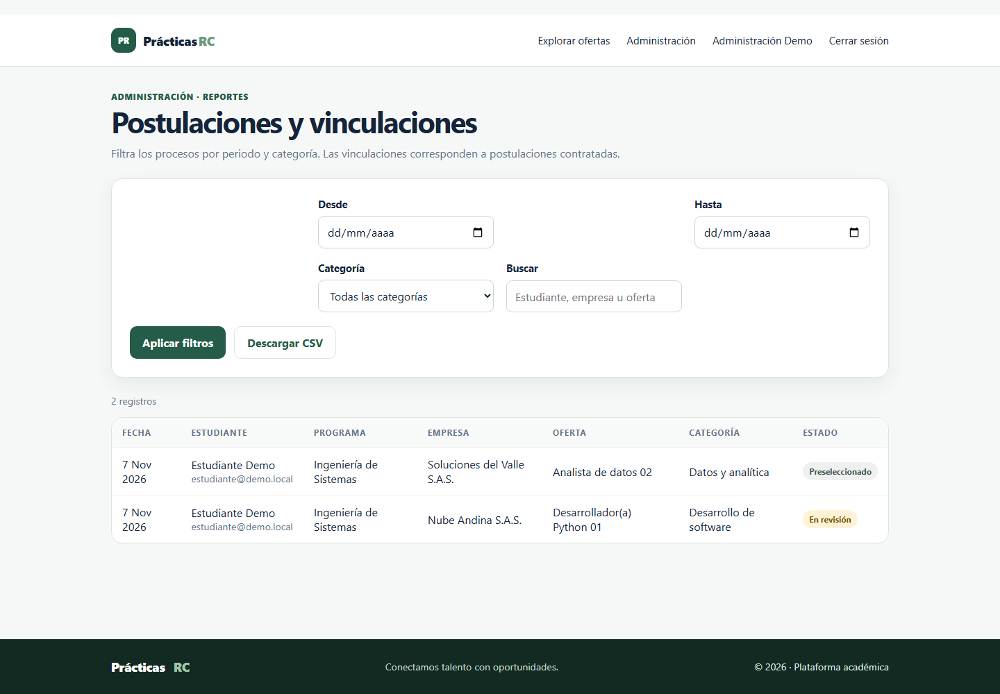

## Cerrar sesión

Usa **Cerrar sesión** en la barra de navegación. El sistema finaliza la sesión y vuelve a la página inicial.

## Cuentas de demostración

Las cuentas y su contraseña de desarrollo local están en el README. No uses esos datos en un entorno publicado.
